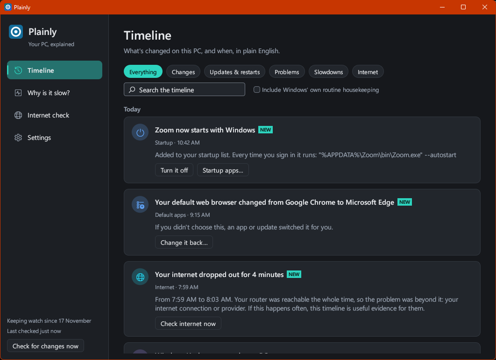
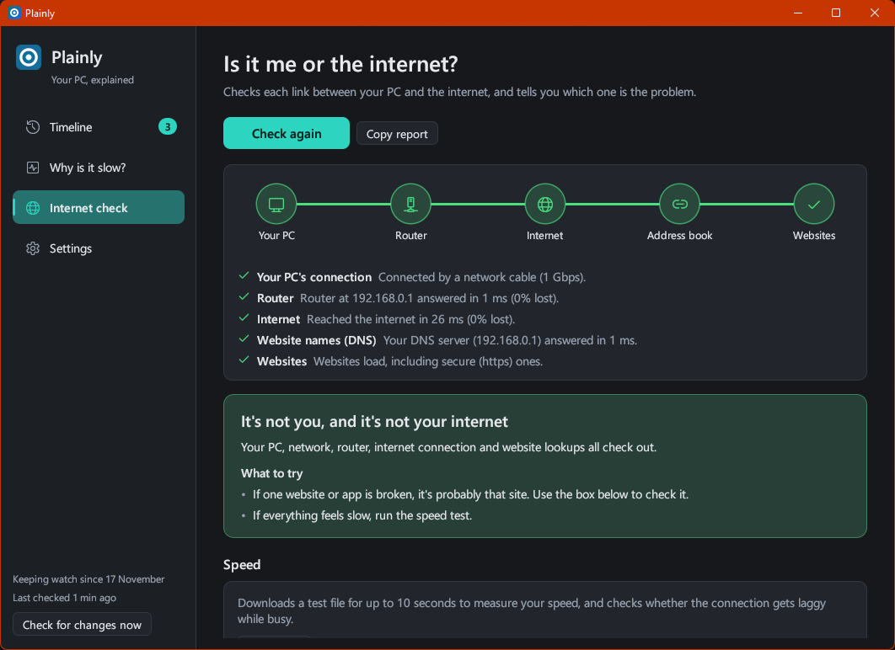
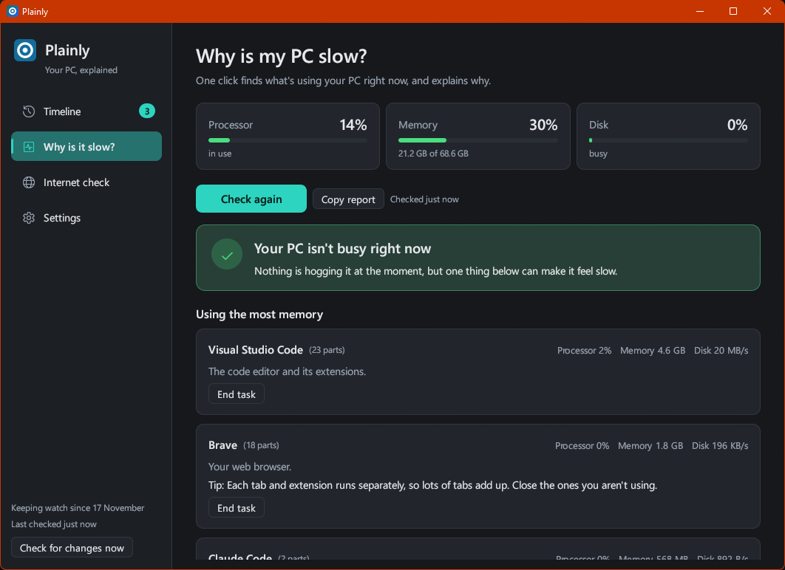
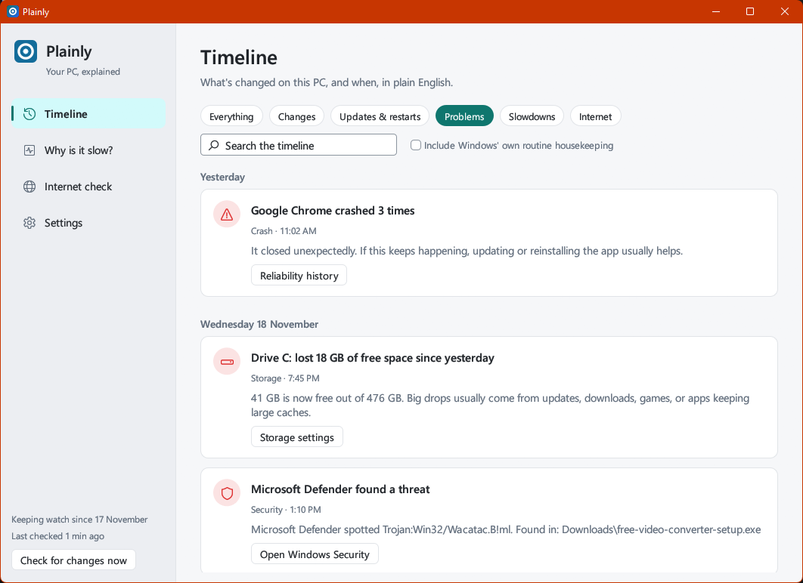

# Plainly

**Your PC, explained in plain English.** A small, free Windows app (6 MB) that lives by the clock and answers three questions people ask all the time:

**[⬇ Download the latest version](https://github.com/strattao1974/plainly/releases/latest)** (Windows 10 and 11)



- **What changed?** A timeline of what happens to your PC behind your back: apps that add themselves to startup, new background services and scheduled tasks, installs and updates, changed default apps (browser, PDF, email…), Windows Update installs and restarts, crashes and blue screens, Microsoft Defender detections, sudden drops in disk space, slowdowns and internet drop-outs. Each entry comes with one-click fixes such as *Turn it off*, *Change it back…* or *Show file*.
- **Why is it slow?** One click names what's using the processor, memory or disk, and says why in words, e.g. *"Windows Update is installing updates"* or *"OneDrive is syncing"*. It also flags the slow-burn causes: weeks without a real restart, an almost-full drive, battery saver, too many startup apps.
- **Is it me or the internet?** Checks every link (PC → Wi-Fi/cable → router → internet → DNS → websites) and names the broken one. Also includes a speed test with a lag-under-load check, a "is this one website down?" checker, and a log of internet drop-outs with who was at fault, which is handy evidence for your provider.

It notifies you (quietly, respecting Do not disturb) only about things that matter: something adding itself to startup, a new background service or task, a changed default app, or a Defender detection.

## Screenshots

| Is it me or the internet? | Why is my PC slow? |
|---|---|
|  |  |

| Problems, in light mode |
|---|
|  |

*The timeline screenshots use sample data; the other two are live checks.*

## Privacy

Full details are in the [privacy policy](PRIVACY.md), which the installer also shows. In short: everything stays on the PC in `%LOCALAPPDATA%\Plainly`. No account, no telemetry, no ads. The only network traffic is for the internet checks: your router, 1.1.1.1 / 8.8.8.8 / 9.9.9.9, `www.msftconnecttest.com` (Windows' own connectivity test), `www.cloudflare.com`, and `speed.cloudflare.com` when you run a speed test. Once a day it asks `api.github.com` whether a newer release exists (you can turn this off in Settings). It only shows a notification and a link to the release page; it never downloads or installs anything itself.

## Requirements

Windows 10 or 11 (64-bit). No admin rights needed, and no runtime to install.

## Building

```powershell
cargo build --release          # target\release\plainly.exe (portable, runs as-is)
cargo test                     # unit tests
cargo test -- --ignored --nocapture   # live checks against this PC and network
iscc installer\plainly.iss     # installer\Output\PlainlySetup.exe (needs Inno Setup 6)
```

Official releases are built by GitHub Actions. See [docs/code-signing.md](docs/code-signing.md) for the release and signing steps.

Run with `--background` to start hidden in the tray, which is what the startup entry uses. Set `PLAINLY_THEME=light` or `dark` to override the system theme.

To take screenshots without showing your own PC's history, generate sample data and point a second copy at it. It runs alongside your normal Plainly:

```powershell
tools\make-demo-data.ps1 -Dir $env:TEMP\plainly-demo
$env:PLAINLY_DATA_DIR = "$env:TEMP\plainly-demo"; target\release\plainly.exe --window
```

## How it works

One exe, two processes, so the always-on part stays tiny:

- **Background watcher** (`plainly.exe`, about 9 MB of memory, ~0.05% CPU): tray icon, notifications and the three watchers. It appends to `timeline.jsonl` and writes `status.json` in the data folder.
- **Window** (`plainly.exe --window`): started from the tray, and fully exits when closed. It reads the timeline, owns `settings.json`, and talks to the watcher with short `WM_COPYDATA` messages (`src/ipc.rs`).

| Part | File |
|---|---|
| Process roles and messages between them | `src/main.rs`, `src/ipc.rs`, `src/shared.rs` |
| Snapshot of startup items, services, tasks, apps, default apps; diffing into events | `src/collect.rs`, `src/snapshot.rs` |
| Windows event logs (updates, restarts, crashes, Defender) | `src/eventlog.rs` |
| Background watchers: changes every 3 min, load every 5 s, internet every 30 s | `src/watcher.rs`, `src/pulse.rs`, `src/netwatch.rs` |
| Process sampling (one `NtQuerySystemInformation` call, works without admin) | `src/perf.rs` |
| Plain-English knowledge base of processes and services | `src/kb.rs` |
| Slowness diagnosis | `src/slow.rs` |
| Network diagnosis, DNS client, WinHTTP | `src/net.rs`, `src/dns.rs`, `src/http.rs` |
| Tray icon and notifications | `src/tray.rs` |
| UI (egui) | `src/app.rs`, `src/theme.rs` |

## Code signing policy

Plainly releases are built from this repository's source by GitHub Actions ([release workflow](.github/workflows/release.yml)). Nothing is built on anyone's own PC.

**Signing status:** releases are currently **unsigned**, so Windows SmartScreen may show "Windows protected your PC" the first time (click **More info → Run anyway**). We plan to apply to the [SignPath Foundation](https://signpath.org)'s free code signing program for open-source projects, and this section will carry their attribution once approved.

**Team roles:**
- Committers and reviewers: [strattao1974](https://github.com/strattao1974). Changes from anyone else arrive as pull requests and are reviewed before merging.
- Approvers (who approve each release for signing): [strattao1974](https://github.com/strattao1974)

**Privacy:** see the [privacy policy](PRIVACY.md). Plainly doesn't send any of what it records to anyone. The only network connections it makes are listed there, and the two background ones can be turned off during installation or in Settings.

## Licence

MIT
